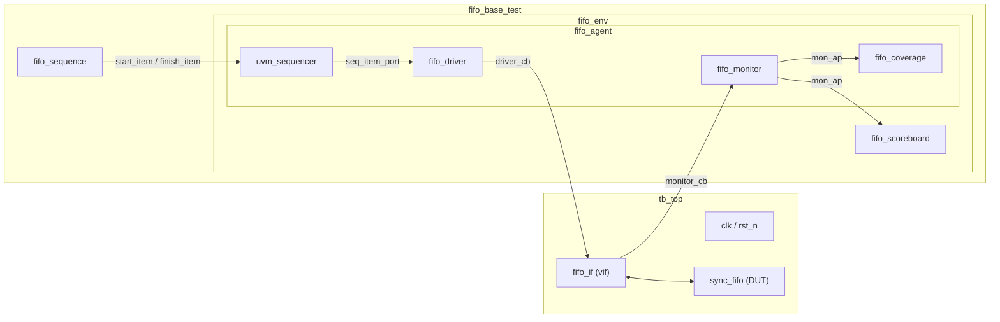

# Synchronous FIFO: UVM Verification Environment

A class-based **UVM 1.1d** testbench that verifies a parameterized synchronous FIFO (`sync_fifo`) in **QuestaSim**. The environment follows the standard agent / environment / scoreboard architecture, with constrained-random stimulus, a reference-model scoreboard and functional coverage.


---

## Table of Contents

1. [Overview](#1-overview)
2. [DUT](#2-dut)
3. [Testbench Architecture](#3-testbench-architecture)
4. [Repository Structure](#4-repository-structure)
5. [Component Description](#5-component-description)
6. [Test Scenario](#6-test-scenario)
7. [Getting Started](#7-getting-started)
8. [Simulation Results](#8-simulation-results)
9. [Verification Notes](#9-verification-notes)
10. [Known Limitations and Roadmap](#10-known-limitations-and-roadmap)
11. [Author](#11-author)

---

## 1. Overview

| Item | Description |
|---|---|
| DUT | Synchronous FIFO, data width 8 bits, address width 4 bits (16 entries) |
| Methodology | UVM 1.1d |
| Language | SystemVerilog |
| Simulator | QuestaSim 10.7c (win64) |
| Stimulus | Constrained-random, 3 sequence modes |
| Checking | Scoreboard with queue-based reference model |
| Coverage | Functional coverage via `covergroup` |
| Automation | Python script for compile, simulate and GUI/batch run |

---

## 2. DUT

`sync_fifo` is instantiated in `tb_top` with:

```systemverilog
sync_fifo #(.DATA_WIDTH(8), .ADDR_WIDTH(4)) dut (...);
```

| Signal | Dir | Width | Description |
|---|---|---|---|
| `clk` | in | 1 | Clock (period 10 ns) |
| `rst_n` | in | 1 | Active-low reset |
| `wr_en` | in | 1 | Write enable |
| `wdata` | in | DATA_WIDTH | Write data |
| `rd_en` | in | 1 | Read enable |
| `rdata` | out | DATA_WIDTH | Read data |
| `full` | out | 1 | FIFO full flag |
| `empty` | out | 1 | FIFO empty flag |

Behavior assumed by the scoreboard: a write while `full` and a read while `empty` have no effect on FIFO contents. The testbench samples `rdata` in the same cycle that `rd_en` is sampled high. See `rtl/sync_fifo.sv` for the exact implementation.

---

## 3. Testbench Architecture



Two independent data paths:

- **Stimulus path:** `fifo_sequence` → sequencer → driver → `fifo_if` → DUT.
- **Observation path:** DUT → `fifo_if` → monitor → analysis port → scoreboard and coverage.

The monitor never uses information from the driver. It reconstructs transactions only from what is visible on the interface, so the checking is independent of the stimulus.

### Phase flow

| Phase | Activity |
|---|---|
| `build_phase` | Create components through the factory, fetch `vif` from `uvm_config_db` |
| `connect_phase` | `driver ↔ sequencer`, `monitor → coverage`, `monitor → scoreboard` |
| `end_of_elaboration_phase` | Print UVM topology |
| `run_phase` | Run the three sequences under an objection |
| `report_phase` | Print coverage and scoreboard summary |

---

## 4. Repository Structure

```
.
├── rtl/
│   └── sync_fifo.sv            # Design under test
├── tb/
│   ├── fifo_if.sv              # Interface with driver/monitor clocking blocks
│   ├── fifo_transaction.sv     # uvm_sequence_item
│   ├── fifo_sequence.sv        # Sequence with WRITE_ONLY / READ_ONLY / RANDOM_MIX modes
│   ├── fifo_driver.sv          # Drives transactions onto the interface
│   ├── fifo_monitor.sv         # Samples the interface, publishes transactions
│   ├── fifo_coverage.sv        # Functional coverage (uvm_subscriber)
│   ├── fifo_scoreboard.sv      # Reference model and data checker
│   ├── fifo_agent.sv           # Groups driver, sequencer, monitor, coverage
│   ├── fifo_env.sv             # Agent and scoreboard, connections
│   ├── fifo_base_test.sv       # Test: runs the three-stage scenario
│   ├── uvm_includes.sv         # Includes all UVM classes in dependency order
│   └── fifo_top.sv             # Top module: clock, reset, DUT, run_test
├── script/
│   └── run_sim.py              # Compile and simulate (batch or GUI)
└── README.md
```

Compilation uses **three** entry files only (`sync_fifo.sv`, `fifo_if.sv`, `fifo_top.sv`). All UVM classes are pulled in by `` `include "uvm_includes.sv" `` inside `fifo_top.sv`, so they share one compilation unit and are registered with the factory.

---

## 5. Component Description

### `fifo_if`: interface

Bundles DUT signals and provides two clocking blocks to avoid testbench/DUT race conditions:

| Clocking block | Used by | Direction |
|---|---|---|
| `driver_cb` | Driver | Drives `wr_en`, `rd_en`, `wdata`. Samples `full`, `empty`, `rdata` |
| `monitor_cb` | Monitor | Samples all signals (inputs only) |

Both use `default input #1step output #0`: inputs are sampled just before the clock edge, outputs change right after it.

### `fifo_transaction`

| Field | Type | Meaning |
|---|---|---|
| `wr_en`, `rd_en` | `rand bit` | Control stimulus |
| `wdata` | `rand bit [7:0]` | Write data |
| `full`, `empty`, `rdata` | `bit` | Observed by the monitor |

Constraint `ctrl_c` biases stimulus: `wr_en` is 1 with 70% weight, `rd_en` is 1 with 50% weight.

### `fifo_sequence`

Three modes selected by `mode`, each running `loop_count` (default 20) items:

| Mode | Constraint | Purpose |
|---|---|---|
| `WRITE_ONLY` | `wr_en=1, rd_en=0` | Fill the FIFO (and overflow it) |
| `READ_ONLY` | `wr_en=0, rd_en=1` | Drain the FIFO (and underflow it) |
| `RANDOM_MIX` | not both 0 | Random read/write mix, including simultaneous |

### `fifo_driver`

Pulls items with `get_next_item`, drives `wr_en/rd_en/wdata` through `driver_cb` for exactly one clock, then deasserts and calls `item_done`. Waits for `rst_n` before driving.

### `fifo_monitor`

One process, sampling every clock through `monitor_cb`. When `wr_en` or `rd_en` is high, it builds a single transaction containing control, data and flags and sends it through `mon_ap`. A single process guarantees a deterministic transaction order when a read and a write occur in the same cycle.

### `fifo_scoreboard`

Reference model: a SystemVerilog queue `golden_queue`.

For every received transaction, in this order:

1. **Read** (`rd_en && !empty`): pop the expected value and compare with `rdata`.
2. **Write** (`wr_en && !full`): push `wdata`.

Read is processed before write because a read in the same cycle returns the older data. Transactions that the DUT ignores (write when full, read when empty) are skipped.

### `fifo_coverage`

`uvm_subscriber` with one covergroup sampling `wr_en`, `rd_en`, `full`, `empty`.

### `fifo_base_test`

Raises an objection, runs the three stages sequentially on `env.agent.sequencer`, waits 100 ns for the pipeline to drain, then drops the objection.

---

## 6. Test Scenario

| Stage | Sequence mode | Items | Intent |
|---|---|---|---|
| 1 | `WRITE_ONLY` | 20 | Fill 16-entry FIFO, push past `full` |
| 2 | `READ_ONLY` | 20 | Drain FIFO, read past `empty` |
| 3 | `RANDOM_MIX` | 20 | Random traffic, simultaneous read and write |

---

## 7. Getting Started

### Prerequisites

- QuestaSim with built-in UVM 1.1d (tested on 10.7c)
- Python 3

### Configure the simulator path

In `script/run_sim.py` set the path to your Questa binaries:

```python
QUESTA_BIN = r"E:\questaaa\win64"   # change to your installation
```

### Run

```bash
cd script

# Batch mode (console log only)
py run_sim.py

# GUI mode (opens waveform window)
py run_sim.py -gui
```

The script removes the old `work` library, compiles the three entry files, and runs `vsim` on `work.tb_top`.

To save the log to a file, add `-l sim.log` to the `vsim` command in `run_sim.py`.

---

## 8. Simulation Results

Last run (`fifo_base_test`, simulation time 715 ns):

```
UVM_INFO [COV_REPORT] FIFO Functional Coverage: 100.00%
UVM_INFO [SCB] FINAL REPORT: Matches: 30, Errors: 0

--- UVM Report Summary ---
UVM_WARNING :    0
UVM_ERROR   :    0
UVM_FATAL   :    0
```

Breakdown of the 30 matches:

| Stage | Driven | Valid reads compared | Notes |
|---|---|---|---|
| 1 `WRITE_ONLY` | 20 | 0 | 16 writes accepted, rest blocked by `full` |
| 2 `READ_ONLY` | 20 | 16 | 16 valid reads, rest blocked by `empty` |
| 3 `RANDOM_MIX` | 20 | 14 | One read hit an empty FIFO and was skipped |
| **Total** | | **30** | |

---

## 9. Verification Notes

Issues found and fixed while bringing the testbench up. They are kept here because they document why the code is written the way it is.

| Symptom | Root cause | Fix |
|---|---|---|
| `Cannot create a component of type 'fifo_base_test' ... not registered with the factory` | Classes were never compiled, because `fifo_top.sv` did not include them | `` `include "uvm_includes.sv" `` in `fifo_top.sv`, compile only 3 entry files |
| `near "uvm_sequence": syntax error` | Class files compiled one by one, each without `import uvm_pkg::*` | Same fix: single compilation unit via includes |
| 0 matches, data shifted by one entry | Monitor waited an extra clock after seeing `rd_en`, skipping every other read | Sample `rdata` in the same cycle as `rd_en` |
| Errors on the last reads and writes | Scoreboard counted writes while `full` and reads while `empty` | Filter on `full` / `empty` |
| Unstable ordering of simultaneous read and write | Separate write and read monitor processes | Single monitor process, scoreboard handles read before write |

---

## 10. Known Limitations and Roadmap

Current limitations:

- Stage 1 drives 20 writes but the monitor reports 19 transactions. Cause not yet confirmed, suspected interaction with reset release at 20 ns. Under investigation using the waveform.
- Scoreboard checks read data only. `full` / `empty` flag correctness and leftover entries at end of test are not checked yet.
- Functional coverage is basic (four 1-bit coverpoints, no crosses).
- Single test and single random seed.

Roadmap:

- [ ] Resolve the 19 vs 20 write discrepancy
- [ ] Scoreboard: flag checks (`full` / `empty`) and leftover-entry report
- [ ] Final PASS / FAIL banner and a driven / monitored / compared summary table
- [ ] Coverage: crosses (`wr_en × full`, `rd_en × empty`, simultaneous read/write), fill-level bins, pointer wrap-around
- [ ] Directed tests: `fill_test`, `drain_test`, `overflow_test`, `underflow_test`, `reset_test`
- [ ] SystemVerilog Assertions in the interface
- [ ] Multi-seed regression and code coverage (line, branch, toggle)
- [ ] Reduce monitor message verbosity to `UVM_HIGH`, add simulation timeout

---
